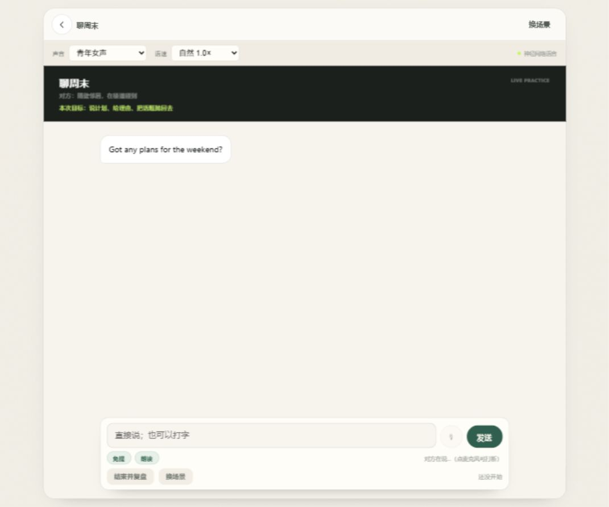
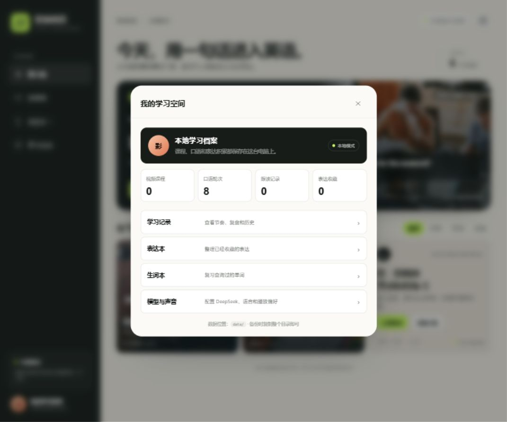

# 影读英语 · Shadow English

> 用真实英语视频练听力，再把学到的表达真正说出口。

影读英语是一个在电脑本地运行的英语口语学习工具。它可以把你喜欢的视频转换为逐句练习，也可以不导入任何视频，直接从真实生活、职场、销售和外贸场景开始开口对话。

视频与录音留在本机；语音识别使用本地 faster-whisper；翻译、教学分析和对话使用你自己的 DeepSeek API Key。


## 这是用来做什么的

传统“看视频学英语”通常停在听懂和看懂，真正开口时仍然会卡住。影读英语把学习过程拆成两条线：

```text
输入：视频 → 字幕 → 精听 → 高频表达 → 跟读/听写/挖空
输出：真实场景 → 语音对话 → 表达评价 → 完整复盘
积累：表达本 + 生词本 + 学习记录
```

适合以下需求：

- 用电影、访谈、Vlog、课程视频练真实英语
- 训练连读、弱读、语速和开口反应
- 积累能直接复用的完整表达，而不是孤立单词
- 模拟咖啡店、求职、会议、销售、外贸等真实对话
- 记录学习节奏、跟读成绩和口语复盘

## 主要功能

### 视频课程

- 支持视频 + SRT/VTT 字幕
- 也可以只提供视频，由本地 Whisper 自动生成带时间戳的英文字幕
- 支持 UTF-8、GBK、UTF-16 字幕
- AI 自动整理被字幕切碎的半句
- AI 批量生成自然中文翻译

### 六种字幕练习

- **精听**：只显示英文，句末停顿
- **双语**：英文和中文同步显示
- **盲听**：先隐藏字幕
- **跟读**：录音后自动识别并评分
- **听写**：按单词比对答案
- **挖空**：自动隐藏关键词

跟读评分综合三个维度：

| 维度 | 权重 | 衡量内容 |
|---|---:|---|
| 完整度 | 50% | 原句中的词读出了多少 |
| 清晰度 | 35% | 识别模型对每个词的置信度 |
| 语速 | 15% | 是否落在自然口语速度范围 |

### AI 表达分析

AI 会从整段视频中挑出约 6–10 个真正值得迁移的表达，并为每个表达提供：

- 原句和中文含义
- 使用场景、对象和语气
- 2–4 个地道替换说法
- 2–3 组不同场景的迁移对话
- 替换练习、情景回应和自主表达


### 场景口语实战

内置日常生活、社交寒暄、讲述观点、职场沟通、销售沟通和外贸实务等场景。

对话时对方会先说英文，你可以点麦克风回答，也可以直接打字。开启免提后，完整流程会自动进行：

```text
对方朗读 → 自动开麦 → 你说话 → 静音自动停止
→ 本地识别 → AI 回应 → 自然语音朗读 → 继续对话
```



### 自然语音

口语页顶部可以选择：

- 青年女声
- 中年女声
- 青年男声
- 沉稳男声
- 英式女声
- 英式男声
- 本地系统语音

还可以选择舒缓、自然、稍快三种语速。神经网络语音需要联网；断网时会自动回退到系统语音，也可以主动选择“本地系统语音”完全离线运行。

### 个人学习空间

侧栏底部的“我的学习空间”会汇总视频课程、口语轮次、跟读次数和收藏数量，并提供学习记录、表达本、生词本、模型与声音设置入口。



## 系统要求

- Windows 10 或 Windows 11
- Node.js 18 或更高版本
- Python 3.11（视频语音识别和自然语音需要）
- 推荐 8 GB 以上内存
- 首次安装语音环境及模型需要网络
- 使用 AI 功能需要 DeepSeek API Key

没有 Python 或不想下载识别模型时，仍然可以使用字幕导入、打字练习和已有字幕功能；视频自动识别、跟读评分和语音对话不可用。

## 下载

### 方式一：下载 ZIP

1. 打开本项目 GitHub 页面
2. 点击绿色的 **Code** 按钮
3. 选择 **Download ZIP**
4. 解压到一个固定目录

### 方式二：Git 克隆

```bash
git clone https://github.com/leeink12-oss/shadow-english.git
cd shadow-english
```

> 不要直接在 ZIP 压缩包内运行。请先完整解压。

## 安装

### 1. 安装 Node.js

打开 <https://nodejs.org/>，下载并安装 **LTS 版本**。

安装完成后，在终端检查：

```bash
node --version
```

能显示版本号即可。

### 2. 安装 Python 3.11

打开 <https://www.python.org/downloads/>，安装 Python 3.11。

Windows 安装界面中请勾选：

- **Add python.exe to PATH**
- **py launcher**

### 3. 安装语音环境

双击：

```text
setup-asr.bat
```

也可以双击中文名版本：

```text
安装语音识别.bat
```

脚本会：

- 创建 `.venv` Python 环境
- 安装 faster-whisper 本地语音识别
- 安装 edge-tts 自然语音依赖
- 可选安装 NVIDIA CUDA 加速组件

第一次识别视频时，程序会下载 Whisper 模型。`small` 约 466 MB，默认 `medium` 约 1.5 GB，下载后可以离线识别。

### 4. 启动

双击：

```text
start.bat
```

也可以双击：

```text
启动影读英语.bat
```

程序会自动打开：

```text
http://127.0.0.1:5178
```

黑色命令行窗口是本地服务器，使用期间不要关闭。关闭窗口后应用停止，但学习数据不会丢失。

## 第一次配置

### 设置 DeepSeek API Key

1. 点击页面右上角 **⚙ 设置**
2. 粘贴 DeepSeek API Key
3. Base URL 保持 `https://api.deepseek.com`
4. 模型保持 `deepseek-chat`
5. 点击保存

API Key 只保存在本机 `data/store.json`，由本地 Node 服务代理调用 DeepSeek，不会写进前端代码。

### 检查语音识别环境

首页顶部会显示“识别服务已就绪”或“识别服务未就绪”。

如果没有就绪：

1. 确认 Python 3.11 已经安装
2. 重新运行 `setup-asr.bat`
3. 重启 `start.bat`

## 使用方法

### 导入视频课程

1. 点击“选择视频”
2. 如有字幕，再点击“添加字幕”
3. 选择识别精度
4. 点击“生成课程”
5. 等待语音识别和翻译完成
6. 在课程页选择对应视频文件开始学习

视频文件本身不会永久复制到项目中，只会在识别期间临时保存。重新打开课程时，需要再次选择原视频。

### 进行跟读练习

1. 进入课程
2. 切换到“跟读”模式
3. 先完整听一遍原句
4. 点击录音并跟读
5. 说完停顿约 1.3 秒，系统自动结束录音
6. 查看漏词、含糊词和语速提示

### 使用场景口语

1. 点击“练口语”或任意场景卡
2. 第一次先选择音色和语速
3. 听对方的问题
4. 点麦克风回答，或直接输入文字
5. 至少完成两轮后点击“结束并复盘”
6. 查看口语评分、对话推进能力和下一条改进建议

### 查看学习记录

点击侧栏“学习记录”可以查看：

- 近 7 天、近 30 天或全部时间的学习活动
- 视频课程、口语轮次、跟读和收藏数据
- 最近一次口语复盘
- 可以点击返回的历史对话和课程

## 数据与隐私

```text
data/
├── store.json        API Key、课程索引、生词、表达、口语记录和设置
├── words.json        单词卡缓存
├── courses/          每门课程的完整字幕、翻译、分析和练习结果
├── tts/              自然语音缓存
├── tmp/              语音识别临时文件
└── trash/            删除课程的回收站
```

隐私边界：

- 视频和原始录音不会上传到第三方
- 语音识别在本机 faster-whisper 中完成
- 字幕文本、用户答案和对话文本会发送给 DeepSeek 做文本处理
- 神经网络朗读的英文文本会发送给 Microsoft Edge TTS
- 如果不希望朗读功能联网，请在口语页选择“本地系统语音”

备份时复制整个 `data/` 目录。`data/store.json` 含有 API Key 和个人学习数据，请不要公开分享。

## 更新

如果使用 Git 克隆：

```bash
git pull
```

依赖版本变化后，重新运行一次：

```text
setup-asr.bat
```

如果使用 ZIP 下载，请重新下载最新版并保留原来的 `data/` 和 `asr/models/` 目录。

## 常见问题

### 双击启动文件后窗口一闪而过

通常是 Node.js 未安装，或者端口已被其他程序占用。先在命令行运行：

```bash
node --version
node server.js
```

查看具体错误。

### 视频有声音但画面黑屏

浏览器通常只可靠支持 MP4（H.264 + AAC）和 WebM。MKV、AVI、部分 HEVC 视频可以交给本地模型识别，但浏览器可能无法播放。请先转换为 MP4。

### 识别环境显示未就绪

确认：

- Python 3.11 已安装
- `py -3.11 --version` 可运行
- 重新执行 `setup-asr.bat`
- `.venv\Scripts\python.exe -m pip check` 没有错误

### AI 返回空内容

设置中的模型应填写：

```text
deepseek-chat
```

不要使用默认开启思考模式的 V4 系模型名作为 `deepseek-chat` 的替代。

### 声音仍然是机械音

检查口语页右侧是否显示“神经网络语音”。如果显示“本地系统语音”，说明网络语音生成失败或你选择了离线模式。选择青年女声、中年女声等任意神经网络声线后，下一句回复会自动重新生成。

### 麦克风不能使用

- 使用 `http://127.0.0.1:5178` 打开
- 在浏览器地址栏允许麦克风
- 确认系统默认输入设备正确
- 手机通过普通局域网 HTTP 打开时，浏览器通常会禁用麦克风

## 技术结构

```text
server.js              本地 HTTP 服务、DeepSeek 代理、数据与 TTS 接口
public/index.html      应用页面
public/css/style.css   页面样式
public/js/app.js       前端总编排
public/js/speaking.js  场景口语与免回复盘
public/js/analysis.js  表达分析、迁移对话和开口练
public/js/records.js   学习记录与复盘汇总
public/js/tts.js       神经网络语音、声线选择与离线回退
public/js/voice.js     录音、语音识别和跟读评分
asr/service.js         Python 进程和语音任务管理
asr/transcribe.py      整段视频识别
asr/worker.py          常驻短音频识别进程
```

前端使用原生 ES Modules，不需要 npm 构建。Node 后端只使用内置模块。

## 开发与贡献

1. 修改 `public/` 后刷新浏览器即可
2. 修改 `server.js` 或 `asr/service.js` 后需要重启
3. 提交前确认没有把 `.env`、`data/`、`.venv/` 或 `asr/models/` 加入 Git
4. 欢迎提交 Issue 描述使用场景、问题复现步骤和预期结果

## 素材说明

首页中的场景图片和影视截图仅用于界面演示，正式发布或商业使用前请替换为已获得授权的素材。Sintel 截图来自 Blender Foundation 的 CC BY 3.0 演示素材。

本项目当前未附带独立开源许可证；对外分发或商业使用前，请先补充合适的许可证并确认第三方依赖与素材授权。
